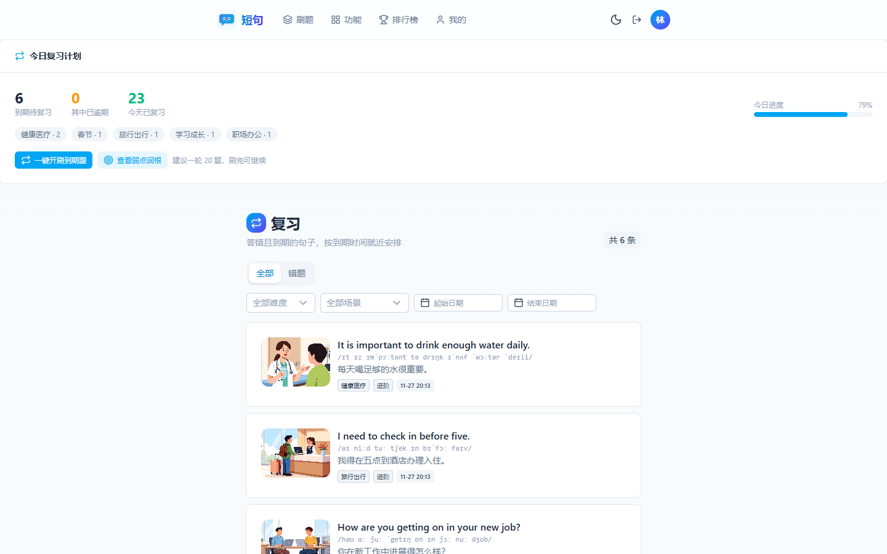
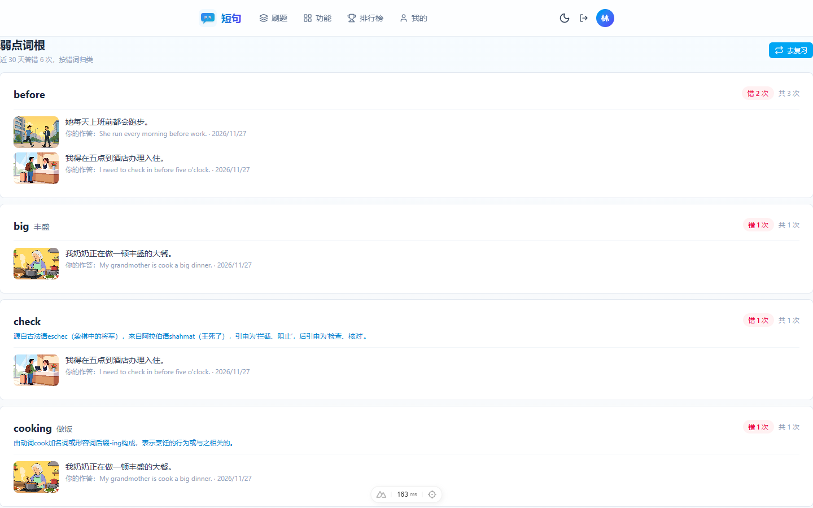
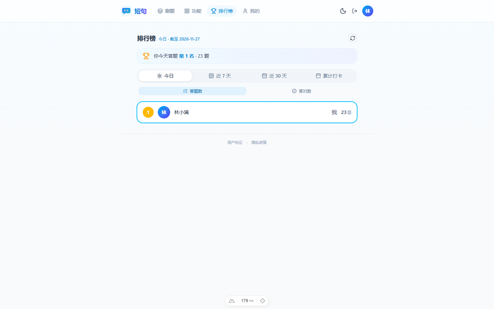
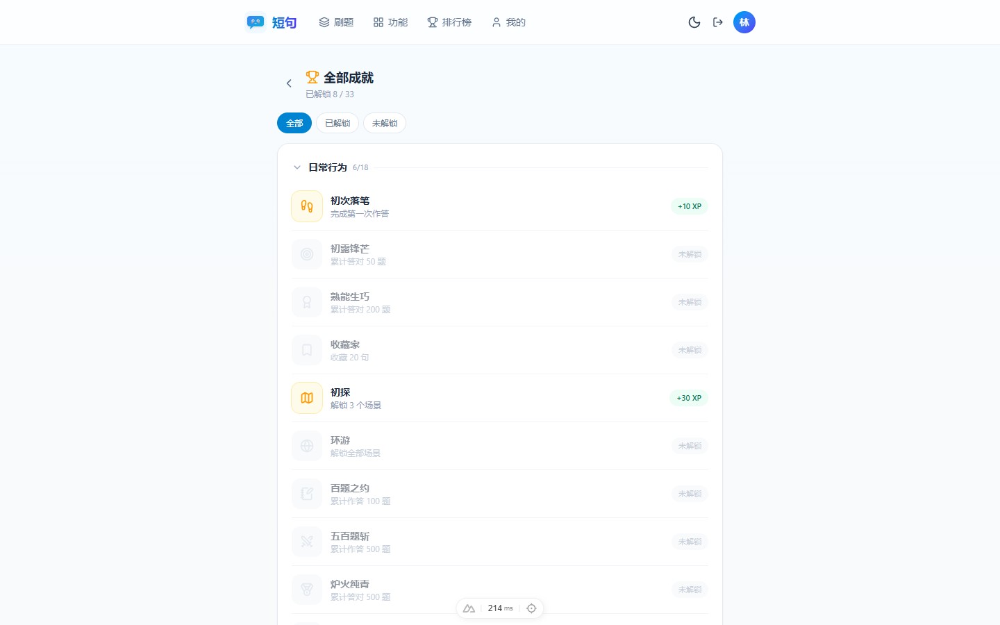
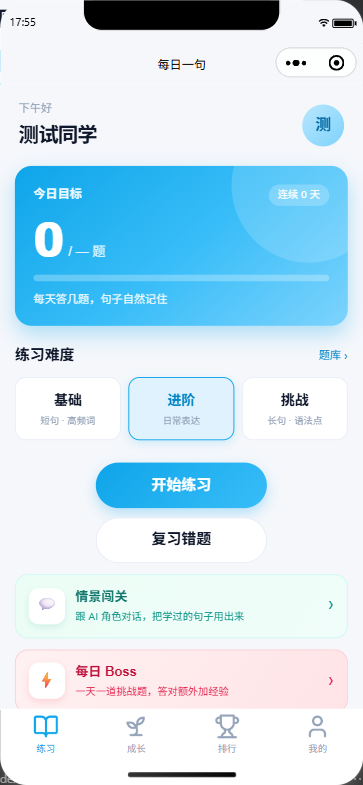
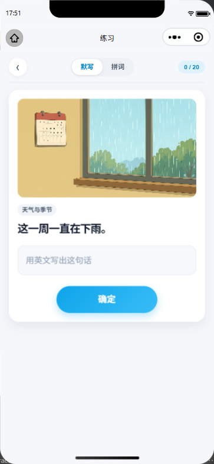
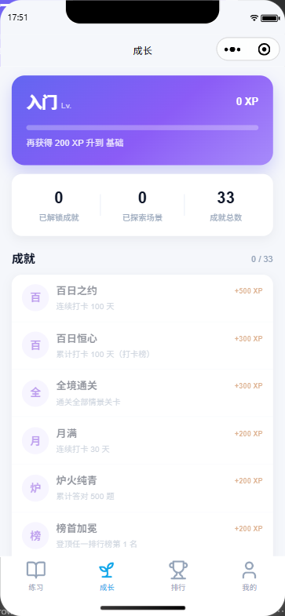
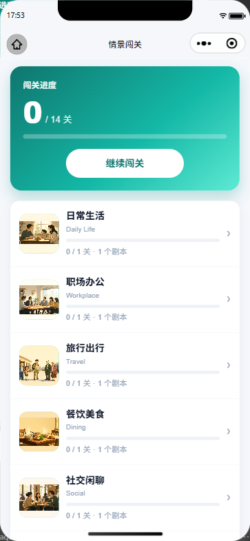
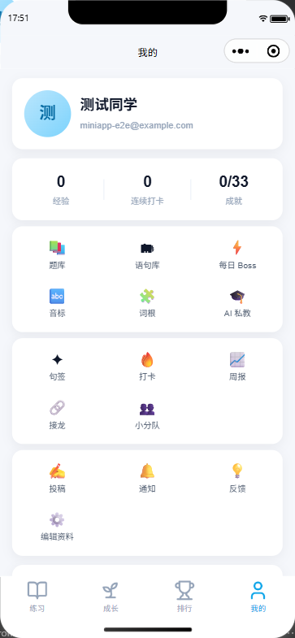

<p align="center">
  
</p>

<h1 align="center">短句（Short Sentence）</h1>

<p align="center">
  
  
  
  
  
  
  
  
  
  
  
  
</p>

> 一个仓库、一套后端、四个用户入口：视觉场景英语闪卡「短句」，把「看中文 → 默写英文 → 场景配图 → 间隔复习」做成每天几分钟的学习闭环。
> 后端 `api/` 同时服务运营后台 `admin/`、用户端 Web `client-web/`、微信小程序 `client-miniapp/` 与 Android App `client-android/`，四端共享同一套接口契约。

| 层         | 技术                                                                                         |
| ---------- | -------------------------------------------------------------------------------------------- |
| 后端       | NestJS 12（纯 ESM）+ Prisma 7 + MySQL 8 + Redis（可选）+ TypeScript，端口 `3000`             |
| 运营后台   | Vue 3.5 + Vite 8 + Element Plus + Tailwind CSS 4 + Pinia，端口 `5173`                        |
| 用户端 Web | Nuxt 4（SSR）+ `@nuxt/ui` 4 + Tailwind CSS 4，端口 `3001`（`strictPort`）                    |
| 微信小程序 | 原生 WXML/WXSS + TypeScript，仅开发期类型依赖                                                |
| Android    | Flutter 3.47 + Riverpod + Dio + go_router，零新增运行时依赖                                  |
| 工程       | Node >= 24、npm、ESLint / oxlint / Prettier / Stylelint、husky + lint-staged、GitHub Actions |

## 界面预览

### Web 端（桌面）

| 首页 · 今日目标与抽题                                            | 复习 · 今日计划                                                    | 弱点词根 · 错词归类                                                      |
| ---------------------------------------------------------------- | ------------------------------------------------------------------ | ------------------------------------------------------------------------ |
|  |  |  |

| 排行榜 · 周期 × 指标                                                      | 成就 · 33 枚徽章                                                         |
| ------------------------------------------------------------------------- | ------------------------------------------------------------------------ |
|  |  |

### 小程序端（移动）

| 首页 · 今日目标                                           | 练习 · 作答闪卡                                              | 成长 · XP 与 33 枚成就                                     |
| --------------------------------------------------------- | ------------------------------------------------------------ | ---------------------------------------------------------- |
|  |  |  |

| 情景闯关 · 四章 14 关                                          | 我的 · 功能入口                                             |
| -------------------------------------------------------------- | ----------------------------------------------------------- |
|  |  |

## 目录

- [界面预览](#界面预览)
- [快速开始](#快速开始)
- [当前业务能力](#当前业务能力)
- [后端约定](#后端约定)
- [各端开发要点](#各端开发要点)
- [常用脚本](#常用脚本)
- [环境变量](#环境变量)
- [部署](#部署)
- [CI 与提交前自检](#ci-与提交前自检)
- [常见问题](#常见问题)
- [许可](#许可)

## 快速开始

### 1. 环境

- Node.js >= 24、npm（仓库 `.npmrc` 使用 npmmirror 镜像）
- MySQL 8（需提前建库，库名与 `DB_NAME` / `DATABASE_URL` 一致）
- Redis 7：可选但推荐；缺失时验证码共享、登录黑名单、限流、AI 配额等增强能力降级
- 仅开发 Android 时需要 Flutter SDK；仅开发小程序时需要微信开发者工具

### 2. 安装依赖

```bash
npm install                        # 根目录：规范工具 + husky 钩子（务必先装）
cd api          && npm install     # 后端
cd ../admin     && npm install     # 运营后台
cd ../client-web && npm install    # 用户端 Web（postinstall 会跑 nuxt prepare）
cd ../client-miniapp && npm install # 小程序（仅 typescript + miniprogram-api-typings）
cd ../client-android && flutter pub get
```

只做后端 + 运营后台时可以跳过 `client-web/` 与移动端依赖。

### 3. 配置

```bash
cd api
cp .env.example .env
```

必须修改：

- `DB_*` / `DATABASE_URL`：`.env.example` 默认库名是 `ly_admin`，本地开发实际使用 `short_sentence`；以你自己 `.env` 的配置为准，建库名必须一致。
- `JWT_ACCESS_SECRET` / `JWT_REFRESH_SECRET`：必填、互不相同，缺失或为空后端拒绝启动。生成：`node -e "console.log(require('crypto').randomBytes(32).toString('hex'))"`。

可选：AI 上游密钥（`AI_*`）缺失只禁用 AI 功能，不阻断启动；邮件（腾讯云 SES）凭证与模板在后台「邮件设置」写入 `sys_config`，不走环境变量。完整变量清单以 `api/.env.example` 为准。

### 4. 建表与种子

```bash
cd api
npm run migrate:deploy             # 应用 prisma/migrations 下全部迁移（首次必执行）
npm run prisma:migrations:check    # 影子库重放迁移后与 schema diff 必须为空
npm run prisma:comments            # 把 schema 的 /// 注释同步为库内 COMMENT（幂等）
npm run seed                       # 可选：服务启动也会幂等执行种子
```

> 表结构变更必须同时改 `prisma/schema/*.prisma` 并补 `migration.sql`，**不要只用 `db push`**。
> `schema` 改了没补迁移，全新部署会缺表/缺列，接口直接 500；`prisma:diff:check` 与提交前门禁会拦截。

### 5. 启动

```bash
npm run dev                 # 后端 :3000 + 运营后台 :5173（后端就绪后才起前端）
npm run dev -- --client     # 再加用户端 Web :3001
```

或分别启动：`npm run dev:api`、`npm run dev:web`、`npm run dev:client`。

- 运营后台：<http://localhost:5173>
- 用户端 Web：<http://localhost:3001>
- 接口根：<http://localhost:3000/api>；探活 `/api/health/live`，含数据库检查的就绪探针 `/api/health/ready`

后端返回的图片地址是 `/static/...` 相对路径，两个前端的 dev proxy 都同时代理 `/api` 和 `/static`，不可省略后者。

默认超管账号 `admin`，初始口令取 `SEED_ADMIN_PASSWORD`，未配置时为开发默认口令（生产必须显式设置并首次登录后改密）。

## 当前业务能力

### 核心学习

- **题库与配图**：14 类生活场景；每日定时生成（AI 生题 → 审核 → 生图 → webp），题目就绪才下发；无配图题不进任何抽题池。
- **作答**：看中文 → 输英文 → 后端权威判分 → 3D 翻转看答案；支持默写 / 拼词 / 盲听三种模式，切模式重新抽题；重复提交只判分不发经验。
- **间隔重复**：答对按 1/3/7/15/30 天递进，答错回到当天；8:2 新题/复习混抽，防重窗口 10；今日复习计划按逾期优先展示，与一键开刷同口径。
- **记忆可视化**：记忆健康页（待复习分布 / 遗忘曲线）、记忆星系；近 30 天错题按词自动归类的「弱点词根」报告。
- **收藏与历史**：收藏夹（支持 Anki 导出）、学习记录、复习池，均支持筛选与分页。

### 成长与留存

- XP + CEFR 六级、33 枚成就、等级环与经验规则全部服务端发放；每日经验上限防刷。
- 7 种排行榜（今日 / 近 7 天 / 近 30 天 × 答题数、答对数 + 累计打卡），60 秒缓存，前 100 竞赛排名。
- 连续打卡与打卡海报、每日句签、学习热力图、每周学习报告（站内 + 可选邮件订阅，默认关闭）。
- 留存六件套：间隔重复、记忆星系、弱连接组队、AI 私教、句子接龙（UGC 三闸审核）、情景闯关。
- 每日学习提醒邮件与后台邮件设置（腾讯云 SES）；客户端公告、产品反馈、单句举报各有独立通道。

### 运营后台

系统管理（用户 / 角色 / 菜单 / 部门 / 字典 / 参数）、三类日志、文件管理、代码生成器、接口文档、在线用户与系统监控；
业务管理覆盖题库与单题重新生图、场景分类、句签与词根、客户端用户与成长详情、排行榜 / 接龙 / 闯关 / 小队、反馈与举报、AI 调用日志与预算、邮件设置。

> 注意：微信支付 / 会员付费功能曾开发后被整体撤销，当前代码库**没有支付模块**。

## 后端约定

- 分层：`module → controller → service`；controller 不碰 `PrismaService`，DTO 必须有 class-validator 装饰器。
- 响应：成功恒 200 `{ code, message, data }`；分页 `{ list, total, page, pageSize }`；BigInt 出参转 `Number`、入参转 `BigInt()`。
- 鉴权：后台走 `sys_user` + `tokenType=admin` + RBAC/数据权限；客户端走 `client_user` + `tokenType=client`，两套彻底隔离，黑名单也带 scope。
- Prisma：目录式 schema 按文件名字典序合并，首行 `// use prisma-next`；列名 snake_case；`///` 注释经 `prisma:comments` 落库。
- 新增 `@Injectable()` 服务必须登记到 `providers` / `exports`，跨模块共用放全局 `CommonModule`；漏登记只有启动或 e2e 会暴露。
- AI：Provider 与业务解耦，Semaphore + 指数退避，调用落 `ai_call_log`；`AiBudgetService` 双闸预算，超额不写日志；默认每人每日额度 `10` 次（环境变量 `AI_DAILY_QUOTA`）。
- 定时任务统一在 `modules/task/task.registry.ts` 注册（含执行体、cron、启停），后台「定时任务」页可见；新增端点后必须执行 `npm run docs:gen`。
- 启动级验证：`npm run build` 后用 `Test.createTestingModule({ imports: [AppModule] }).compile()` 抓依赖注入错误；真实库冒烟用 dist 手工 new Service。

## 各端开发要点

**admin（Vue 3）**：`script setup` + TS，组件/API 自动导入；Element Plus 命令式 API 统一走 `src/utils/element` 桶，纵向滚动一律 `el-scrollbar`（禁止 `overflow-y-auto`），弹窗走 `BasicDialog`、分页走 `Pagination`。

**client-web（Nuxt 4）**：`app.vue` 是 `<UApp><NuxtLayout><NuxtPage/></NuxtLayout></UApp>` 唯一入口，外壳在 `layouts/default.vue`，认证页走 `layouts/auth.vue`，禁止 `definePageMeta({ layout: false })`；令牌用 Cookie + localStorage 双写供 SSR 读取；私有页同步加入 `nuxt.config.ts` 的 `robots.disallow` 与 `sitemap.exclude`；`nuxt build` **不做类型检查**，必须单独跑 `npm run type-check`。

**client-miniapp**：页面四件套（ts/json/wxml/wxss）；`npm run check` 校验事件绑定、标签闭合、`wx:key` 与样式类；`utils/env.ts` 配置接口基址，真机预览改为电脑局域网 IP。

**client-android**：页面为 `lib/pages/`，控制器在 `lib/state/`，API 与模型在 `lib/api/`；动效取 `Motion` 令牌，Widget 测试须设 `Motion.loopAnimations = false`；模拟器接口基址默认 `10.0.2.2:3000/api`，对外分发必须 `--dart-define=API_BASE_URL=https://<域名>/api` 重新构建。

## 常用脚本

| 位置              | 命令                                                                                                                  | 说明                                 |
| ----------------- | --------------------------------------------------------------------------------------------------------------------- | ------------------------------------ |
| 根                | `npm run dev` / `npm run dev -- --client`                                                                             | 有序启动后端 + admin（+ 用户端 Web） |
| 根                | `npm run lint` / `format:check` / `stylelint`                                                                         | 全仓规范检查                         |
| 根                | `npm run guard:deps` / `guard:imports` / `guard:locale` / `guard:scrollbar` / `guard:components` / `guard:migrations` | 工程门禁                             |
| 根                | `npm run check:miniapp` / `db:backup` / `db:drill`                                                                    | 小程序自检 / 数据库备份与恢复演练    |
| `api/`            | `npm run typecheck` / `lint` / `test` / `test:e2e`                                                                    | 后端检查（e2e 需本地 MySQL + Redis） |
| `api/`            | `migrate:deploy` / `migrate:status` / `prisma:diff:check` / `prisma:comments` / `docs:gen`                            | 迁移、结构门禁、注释同步、接口文档   |
| `admin/`          | `npm run type-check` / `test` / `build`                                                                               | 后台检查与构建                       |
| `client-web/`     | `npm run type-check` / `test` / `build`                                                                               | 用户端检查与构建                     |
| `client-miniapp/` | `npm run type-check` / `check`                                                                                        | 小程序检查                           |
| `client-android/` | `flutter analyze` / `flutter test` / `flutter build apk`                                                              | Android 检查与打包                   |

## 环境变量

以 `api/.env.example` 为唯一模板，高频项：

| 变量                                                          | 说明                                                       |
| ------------------------------------------------------------- | ---------------------------------------------------------- |
| `PORT`                                                        | 后端端口，固定 `3000`                                      |
| `DB_HOST` / `DB_PORT` / `DB_NAME` / `DB_USER` / `DB_PASSWORD` | MySQL 连接（`DATABASE_URL` 可整体覆盖）                    |
| `JWT_ACCESS_SECRET` / `JWT_REFRESH_SECRET`                    | 必填且互不相同                                             |
| `JWT_ACCESS_EXPIRES_IN` / `JWT_REFRESH_EXPIRES_IN`            | 默认 `2h` / `7d`                                           |
| `SEED_ADMIN_PASSWORD`                                         | 种子超管口令，生产必须显式设置                             |
| `REDIS_HOST` / `REDIS_PORT` / `REDIS_PASSWORD`                | 留空 `REDIS_HOST` 视为不启用并降级                         |
| `CORS_ORIGIN` / `UPLOAD_ALLOWED_REFERERS`                     | 含 admin `:5173` 与 client-web `:3001`，图片防盗链依赖后者 |
| `AI_DAILY_QUOTA`                                              | 每人每日 AI 调用额度，默认 `10`                            |
| `UPLOAD_DIR` / `WEB_DIST_DIR`                                 | 上传与前端同源托管目录（相对 `api/`）                      |
| `LOG_*` / `IP2REGION_DB_PATH` / `NET_DEV_PATH`                | 日志、IP 归属地、网卡统计（详见 `.env.example`）           |

## 部署

- **同源部署**：`cd admin && npm run build:only -- --outDir ../api/web --emptyOutDir`，后端启动时自动托管 `api/web/` 并对 SPA history 回退；产物目录可用 `WEB_DIST_DIR` 覆盖。
- **分离部署**：前端静态服务器 + 后端独立进程；后端配置 `CORS_ORIGIN` 与 `UPLOAD_ALLOWED_REFERERS`，网关必须转发 `/api` 与 `/static`。
- **用户端 Web**：SSR 常驻进程，`cd client-web && npm ci && npm run build && node .output/server/index.mjs`；服务端注入 `NUXT_API_INTERNAL_URL`（如 `http://api:3000/api`），`NUXT_PUBLIC_SITE_URL` 用于 canonical/sitemap/og。
- **Android**：`cd client-android && flutter build apk --release`；正式包必须改 `lib/config/app_config.dart` 的接口基址并自带 `INTERNET` 权限。
- **Docker**：`deploy/docker-compose.yml` 一条命令起 MySQL / Redis / 迁移 / API；部署环境变量模板见 `deploy/.env.example`。

## CI 与提交前自检

`.github/workflows/ci.yml` 覆盖：`guards`（格式 / lint / 依赖基线 / 导入追踪 / 语言包 / 滚动条）、`api`（类型 / lint / 单测 / 迁移 / 结构 diff / 注释 / e2e）、`web`、`client`、`miniapp`、`android`、镜像构建与 compose 冒烟。

推送前建议本地跑：

```bash
npm run format:check && npm run lint && npm run stylelint
npm run guard:deps && npm run guard:imports && npm run guard:locale \
  && npm run guard:scrollbar && npm run guard:components && npm run guard:migrations
(cd api && npm run typecheck && npm run lint && npm run test && npm run test:e2e)
(cd admin && npm run type-check && npm run test)
(cd client-web && npm run type-check && npm run test)
(cd client-miniapp && npm run type-check && npm run check)
(cd client-android && flutter analyze && flutter test)
```

本仓库双远端：`origin` = Gitee（主），`github` = GitHub（镜像），提交后两边都要推。

## 常见问题

**Q：JWT 相关错误导致启动失败？** `JWT_ACCESS_SECRET` / `JWT_REFRESH_SECRET` 必填且必须不同，见快速开始第 3 步。

**Q：服务起来了但接口 500 / 报缺表？** 先查 `cd api && npm run migrate:status` 是否有 pending 迁移，再 `npm run migrate:deploy`；不要先查编译。改了 schema 没补迁移是最常见原因。

**Q：Redis 连接失败？** 主流程不阻断，验证码共享 / 黑名单 / 限流 / AI 配额会降级；本机没装 Redis 时属预期，装好并配置 `REDIS_HOST` 即恢复。

**Q：端口冲突？** api `3000`、admin `5173`、client-web `3001` 均固定并 `strictPort`；改端口须同步 `api/.env` 的 `CORS_ORIGIN` 与 `UPLOAD_ALLOWED_REFERERS`，以及前端 proxy 目标。

**Q：admin 改样式后门禁失败？** 纵向滚动必须用 `el-scrollbar`，弹窗用 `BasicDialog`，分页用 `Pagination`；门禁为 `guard:scrollbar` / `guard:components`。

**Q：Nuxt 构建通过但类型报错？** `nuxt build` 不做类型检查，必须单独跑 `npm run type-check`。

**Q：图片 404？** 确认后端 `UPLOAD_DIR` 可写、前端代理了 `/static`；分离部署时把前端 origin 加进 `UPLOAD_ALLOWED_REFERERS`。

**Q：新增了接口但文档页看不到？** 执行 `npm run docs:gen`（`api` 的 `build` 会自动跑），接口清单由控制器源码生成。

## 许可

[MIT](./LICENSE)
